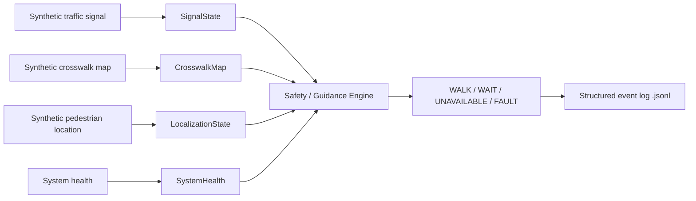

# TRIVENI-ITS: Core Guidance & Safety Emulator (Milestone 01, v0.1)

**Traffic-Responsive Infrastructure for Visually-impaired Enablement at Intersections**

TRIVENI helps blind, low-vision and other vulnerable pedestrians cross signalized intersections by combining traffic-signal state, crosswalk geometry, pedestrian location and confidence, and system health into one safe guidance decision.

This repository is **Milestone 01**: a pure-software, technology-independent safety core. It uses synthetic inputs only. No BLE, UWB, GPS, Android app or real traffic controller is involved yet.

> **The question this code answers, once per tick:**
> *Given signal state, crosswalk information, pedestrian position/confidence, timing, and system health, what guidance should TRIVENI produce?*

The output is exactly **one** of `WALK | WAIT | UNAVAILABLE | FAULT`, plus one or more reason codes. Every decision is logged.

---

## Table of contents

1. [Quick start](#quick-start)
2. [Safety principles](#safety-principles)
3. [How it works](#how-it-works)
4. [Repository structure](#repository-structure)
5. [Data models](#data-models)
6. [Configuration](#configuration)
7. [Demo intersection: Kemps Corner](#demo-intersection-kemps-corner)
8. [Demos](#demos)
9. [Tests](#tests)
10. [Decision log](#decision-log)
11. [Reason codes](#reason-codes)
12. [Known limitations and assumptions](#known-limitations-and-assumptions)
13. [Out of scope for Milestone 01](#out-of-scope-for-milestone-01)

---

## Quick start

Requires Python 3.x and Git.

```bash
# 1. Create and activate a virtual environment
python -m venv .venv

# Windows
.venv\Scripts\activate
# macOS / Linux
source .venv/bin/activate

# 2. Install dependencies
pip install -r requirements.txt

# 3. Run all demos
python run_demo.py

# Optional: pause between demos (for live demo / screen recording)
python run_demo.py --pause

# 4. Run the automated tests
pytest -v
```

---

## Safety principles

These rules shape every line of the code.

1. TRIVENI **never controls or alters** the traffic signal. Any future connection must be authorized and read-only.
2. A signal showing `WALK` is **not sufficient by itself** to tell a pedestrian to cross.
3. A positive crossing recommendation depends on **multiple validated conditions**.
4. Stale, contradictory, missing or low-confidence information is **never converted into certainty**.
5. If required information is unavailable or unreliable, the system **fails conservatively** toward `WAIT`, `UNAVAILABLE` or `FAULT`.
6. Every guidance decision can be **reconstructed from logs**.
7. No core module is hard-wired to one technology (BLE, UWB, GPS, computer vision).

> **Safety rule:** the software must never produce `WALK` if any mandatory safety predicate is invalid.
> **Acceptance metric:** false `WALK` events in defined invalid scenarios = **0**.

---

## How it works



Future technologies connect through adapters that convert real data into these same internal objects:

| Future technology | Internal TRIVENI object |
|---|---|
| Traffic controller / simulator | `SignalState` |
| UWB / BLE / GNSS / vision / fusion | `LocalizationState` |
| J2735 MAP / GeoJSON / manual map | `CrosswalkMap` |
| Edge hardware monitoring | `SystemHealth` |
| Android / wearable | `GuidanceDecision` |

### The six safety predicates

`WALK = Sv ∧ Cv ∧ Lv ∧ Fv ∧ Hv ∧ Tv`

| Predicate | Meaning | If it fails |
|---|---|---|
| **Sv** | Signal state is valid and is `WALK` | `WAIT` |
| **Cv** | Crosswalk is established: the position circle overlaps exactly one crosswalk, in its entry zone | `UNAVAILABLE` |
| **Lv** | Localization is present, from the same intersection, with uncertainty ≤ max | `UNAVAILABLE` |
| **Fv** | Required information is fresh, and timestamps are consistent | `UNAVAILABLE` |
| **Hv** | Required system components are healthy | `FAULT` (or `UNAVAILABLE` if only degraded) |
| **Tv** | Enough walk time remains | `WAIT` |

**Priority (most conservative wins):** `FAULT > UNAVAILABLE > WAIT > WALK`

The engine collects **all** failures in a tick, picks the most conservative decision, and keeps every reason code. It is pure and deterministic: no wall-clock access, no hidden state, no side effects. Any uncaught exception becomes `FAULT / UNKNOWN_ERROR`, never `WALK`.

### Per-tick decision loop

```
for every tick:
    1.  Check intersection identity
    2.  Check crosswalk identity        (find zone overlaps)
    3.  Check signal state              (WALK / DONT_WALK / CLEARANCE)
    4.  Check signal freshness and timestamp validity
    5.  Check localization freshness and timestamp validity
    6.  Check localization uncertainty
    7.  Check system health
    8.  Check timing                    (remaining walk time)
    9.  Produce exactly ONE guidance state
    10. Produce one or more reason codes
```

### Pedestrian position as an uncertainty circle

The pedestrian's position is not a point. It is a circle:

- **centre** = `(x_m, y_m)`
- **radius** = `position_uncertainty_m`

The engine tests whether this circle overlaps each crosswalk zone (`CrosswalkMap.which_crosswalk_zones_overlap`). A circle that touches zones of more than one crosswalk means the system cannot be sure where the pedestrian is, so it returns `CROSSWALK_AMBIGUOUS`. Touching counts as overlapping, which is the conservative direction.

Each crosswalk has two zones, given as polygons in meters from the intersection centre:

- **Entry zone**: where the pedestrian *waits* to cross (curb side).
- **Exit zone**: the far side (destination side).

### SPaT mapping (Signal Phase and Timing)

| Physical display | `signal_state` value |
|---|---|
| Pedestrian green man | `WALK` |
| Flashing hand (clearance) | `CLEARANCE` |
| Red man | `DONT_WALK` |

| Field | Meaning |
|---|---|
| `remaining_time_ms` | Time left in the current phase |
| `source_timestamp_ms` | When the controller produced the data |
| `receive_timestamp_ms` | When pedestrain's device received it |

**Signal age** = `now_ms - source_timestamp_ms`. The signal is stale if its age exceeds `signal_freshness_ms`. Only the **pedestrian signal** of each crosswalk is used.

---

## Repository structure

```
triveni/
├── README.md
├── requirements.txt
├── run_demo.py                      # runs the demo scenarios
├── config/
│   └── triveni.yaml                 # all safety thresholds
├── data/
│   └── intersection_demo.json       # Kemps Corner map
├── triveni/
│   ├── models/
│   │   ├── signal_state.py
│   │   ├── localization_state.py
│   │   ├── system_health.py
│   │   ├── crosswalk_map.py         # geometry + zone-overlap queries
│   │   └── guidance_decision.py
│   ├── simulator/
│   │   ├── signal_simulator.py      # WALK, DON'T WALK, missing, stale, delayed...
│   │   └── pedestrian_simulator.py  # named localization presets
│   ├── safety/
│   │   └── safety_engine.py         # the decision logic
│   └── logging/
│       └── event_logger.py          # JSON Lines logger
└── tests/
    └── test_safety_engine.py
```

---

## Data models

Each model validates its required fields and rejects clearly invalid input (missing intersection ID, negative uncertainty, unsupported signal state, invalid health value).

| Model | Purpose | Key fields |
|---|---|---|
| `SignalState` | Pedestrian signal for one crosswalk | `intersection_id`, `crosswalk_id`, `signal_state`, `remaining_time_ms`, `source_timestamp_ms`, `receive_timestamp_ms`, `source_health` |
| `LocalizationState` | Estimated pedestrian position | `intersection_id`, `x_m`, `y_m`, `heading_deg`, `position_uncertainty_m`, `localization_source`, `timestamp_ms`, `health` |
| `CrosswalkMap` | Intersection geometry | `intersection_id`, crosswalks with `entry_zone`, `exit_zone`, `heading_deg` |
| `SystemHealth` | Component status | `edge_service`, `signal_input`, `localization_input`, `map_loaded`, `clock_status` |
| `GuidanceDecision` | Engine output | `decision`, `reason_codes`, `intersection_id`, `crosswalk_id`, `decision_timestamp_ms` |

`localization_source` is always `"SIMULATED"` in this milestone.

---

## Configuration

All safety thresholds live in `config/triveni.yaml`, never in code. The values below are initial engineering values for testing and are meant to be tuned through experiments.

```yaml
signal_freshness_ms: 500
localization_freshness_ms: 500
max_position_uncertainty_m: 1.5
minimum_remaining_walk_time_ms: 5000
require_remaining_time: true
wrong_intersection_result: UNAVAILABLE   # or FAULT
```

| Key | Meaning |
|---|---|
| `signal_freshness_ms` | Maximum allowed signal age |
| `localization_freshness_ms` | Maximum allowed localization age |
| `max_position_uncertainty_m` | Maximum allowed uncertainty radius |
| `minimum_remaining_walk_time_ms` | Minimum walk time needed to start crossing |
| `require_remaining_time` | If `true`, a missing `remaining_time_ms` blocks `WALK` |
| `wrong_intersection_result` | Decision for data from the wrong intersection |

---

## Demo intersection: Kemps Corner

`data/intersection_demo.json` models **INT_KEMPS_CORNER** (Kemps Corner, Mumbai).

Top-level fields:

| Field | Value |
|---|---|
| `intersection_id` | `INT_KEMPS_CORNER` (must match the ID in `SignalState` and `LocalizationState`) |
| `name` | `Kemps Corner, Mumbai` |
| `units` | `meters` |
| `origin` | intersection centre `(0, 0)`; `+x` = East, `+y` = North |
| `crosswalks` | list of the four crosswalks below |

`heading_deg` is the walking direction from the entry zone to the exit zone: 0° = East, 90° = North, 180° = West, 270° = South (counter-clockwise from East).

Each crosswalk is named after the side of the intersection where it sits. Each zone is a rectangle, stored as four `[x, y]` vertices.

| Crosswalk | `heading_deg` | Walking direction | Entry zone (red) | Exit zone (green) |
|---|---|---|---|---|
| `CW_NORTH` | 180 | West | x 3 to 8, y 8 to 11 | x -8 to -3, y 8 to 11 |
| `CW_EAST` | 90 | North | x 8 to 11, y -8 to -3 | x 8 to 11, y 3 to 8 |
| `CW_SOUTH` | 0 | East | x -8 to -3, y -11 to -8 | x 3 to 8, y -11 to -8 |
| `CW_WEST` | 270 | South | x -11 to -8, y 3 to 8 | x -11 to -8, y -8 to -3 |

Exact vertices as stored in the JSON:

```json
{
  "intersection_id": "INT_KEMPS_CORNER",
  "name": "Kemps Corner, Mumbai",
  "units": "meters",
  "origin": "intersection center (0,0); +x East, +y North",
  "crosswalks": [
    {"crosswalk_id": "CW_NORTH", "entry_zone": [[3,8],[8,8],[8,11],[3,11]],         "exit_zone": [[-8,8],[-3,8],[-3,11],[-8,11]],       "heading_deg": 180},
    {"crosswalk_id": "CW_EAST",  "entry_zone": [[8,-8],[11,-8],[11,-3],[8,-3]],     "exit_zone": [[8,3],[11,3],[11,8],[8,8]],            "heading_deg": 90},
    {"crosswalk_id": "CW_SOUTH", "entry_zone": [[-8,-11],[-3,-11],[-3,-8],[-8,-8]], "exit_zone": [[3,-11],[8,-11],[8,-8],[3,-8]],       "heading_deg": 0},
    {"crosswalk_id": "CW_WEST",  "entry_zone": [[-11,3],[-8,3],[-8,8],[-11,8]],     "exit_zone": [[-11,-8],[-8,-8],[-8,-3],[-11,-3]],   "heading_deg": 270}
  ]
}
```

Note that the `CW_NORTH` entry zone and the `CW_EAST` exit zone meet at the corner **(8, 8)**. A pedestrian standing there is genuinely ambiguous, which is what Demo B shows.

### Named pedestrian presets

Defined in `triveni/simulator/pedestrian_simulator.py`:

| Preset | Position | Expected result (if everything else is valid) |
|---|---|---|
| `near_correct_crosswalk` | (5.5, 9.5) | `WALK`, inside `CW_NORTH` entry only |
| `low_uncertainty` | (5.5, 9.5), 0.3 m | `WALK` |
| `near_wrong_crosswalk` | (-9.5, 5.5) | `UNAVAILABLE / CROSSWALK_MISMATCH` when intended is `CW_NORTH` |
| `between_two_crosswalks` | (8.0, 8.0) | `UNAVAILABLE / CROSSWALK_AMBIGUOUS` |
| `high_uncertainty` | (5.5, 9.5), 2.0 m | `UNAVAILABLE / LOCALIZATION_UNCERTAINTY_TOO_HIGH` |
| `missing_localization` | none | `UNAVAILABLE / LOCALIZATION_MISSING` |
| `stale_localization` | (5.5, 9.5), old timestamp | `UNAVAILABLE / LOCALIZATION_STALE` |
| `wrong_intersection_id` | (5.5, 9.5) | `UNAVAILABLE` or `FAULT` / `WRONG_INTERSECTION` |
| `not_in_any_zone` | (0, 0) | `UNAVAILABLE / CROSSWALK_NOT_ESTABLISHED` |

All timestamps are passed in explicitly. No wall-clock is used, so every scenario is repeatable.

---

## Demos

Run with `python run_demo.py`.

| Demo | Scenario | Expected output |
|---|---|---|
| **A: Valid crossing** | `CW_NORTH` = WALK, pedestrian at (5.5, 9.5), fresh data, healthy system | `WALK` / `ALL_REQUIRED_CONDITIONS_VALID` |
| **B: Ambiguous crosswalk** | `CW_NORTH` = WALK, pedestrian at (8.0, 8.0), the shared corner of `CW_NORTH` entry and `CW_EAST` exit | `UNAVAILABLE` / `CROSSWALK_AMBIGUOUS` |
| **C: Stale signal** | `CW_NORTH` = WALK, signal age 900 ms (above the 500 ms threshold) | `UNAVAILABLE` / `SIGNAL_STALE` |
| **D: Don't walk** | `CW_NORTH` = DONT_WALK | `WAIT` / `SIGNAL_NOT_WALK` |

---

## Tests

```bash
pytest -v
```

`tests/test_safety_engine.py` covers the mandatory scenarios from the milestone spec, plus additional cases found during implementation:

| Scenario | Expected state |
|---|---|
| WALK + correct crosswalk + good localization + fresh data | `WALK` |
| DON'T WALK signal | `WAIT` |
| Signal missing | `UNAVAILABLE` |
| Signal stale | `UNAVAILABLE` |
| Localization missing | `UNAVAILABLE` |
| Localization uncertainty too high | `UNAVAILABLE` |
| Wrong intersection ID | `FAULT` or `UNAVAILABLE` (configurable) |
| Crosswalk ambiguous | `UNAVAILABLE` |
| Critical component unhealthy | `FAULT` |
| WALK changes to DON'T WALK | leaves `WALK` immediately |

---

## Decision log

Every decision writes one JSON record (JSON Lines, `.jsonl`), including the evidence needed to reconstruct why it happened:

```json
{
  "decision_timestamp_ms": 100050,
  "intersection_id": "INT_KEMPS_CORNER",
  "crosswalk_id": "CW_NORTH",
  "signal": "WALK",
  "signal_age_ms": 50,
  "position_uncertainty_m": 0.75,
  "crosswalk_match": true,
  "signal_valid": true,
  "localization_valid": true,
  "system_healthy": true,
  "decision": "WALK",
  "reason_codes": ["ALL_REQUIRED_CONDITIONS_VALID"]
}
```

Alongside these fields the engine records predicate results (`Sv` to `Tv`), candidate crosswalks, ages, remaining time and the thresholds used.

---

## Reason codes

| Code | Result | Meaning |
|---|---|---|
| `ALL_REQUIRED_CONDITIONS_VALID` | WALK | All predicates passed |
| `SIGNAL_NOT_WALK` | WAIT | Signal is `DONT_WALK` or `CLEARANCE` |
| `INSUFFICIENT_REMAINING_TIME` | WAIT | Remaining walk time below the minimum, or missing when required |
| `SIGNAL_MISSING` | UNAVAILABLE | No `SignalState` for the established crosswalk |
| `SIGNAL_STALE` | UNAVAILABLE | Signal age > `signal_freshness_ms` |
| `SIGNAL_TIMESTAMP_INVALID` | UNAVAILABLE | Contradictory or future source timestamp |
| `LOCALIZATION_MISSING` | UNAVAILABLE | No localization data |
| `LOCALIZATION_STALE` | UNAVAILABLE | Localization age > `localization_freshness_ms` |
| `LOCALIZATION_TIMESTAMP_INVALID` | UNAVAILABLE | Negative or future localization timestamp |
| `LOCALIZATION_UNCERTAINTY_TOO_HIGH` | UNAVAILABLE | Uncertainty > `max_position_uncertainty_m` |
| `WRONG_INTERSECTION` | UNAVAILABLE / FAULT | Data belongs to a different intersection |
| `CROSSWALK_AMBIGUOUS` | UNAVAILABLE | Position circle overlaps zones of more than one crosswalk |
| `CROSSWALK_NOT_ESTABLISHED` | UNAVAILABLE | Position is not in any entry zone |
| `CROSSWALK_MISMATCH` | UNAVAILABLE | Established crosswalk differs from the intended one |
| `SYSTEM_DEGRADED` | UNAVAILABLE | A component is `DEGRADED` and none is `FAULT` |
| `SYSTEM_UNHEALTHY` | FAULT | A critical component is `FAULT`, or health or map is missing |
| `UNKNOWN_ERROR` | FAULT | Unexpected exception; never `WALK` |

---

## Known limitations and assumptions

**Limitations**

- **Mid-crossing guidance is not defined.** Once a pedestrian leaves the entry zone, the engine returns `UNAVAILABLE / CROSSWALK_NOT_ESTABLISHED`. This is intentional. Milestone 02 will define mid-crossing and exit-zone behavior.
- `localization_source` must be `"SIMULATED"`. Real adapters will add other allowed values.
- `heading_deg` is stored in the map and localization but is not yet used in any safety predicate.
- No hardware integration of any kind.

**Assumptions** (where the spec was ambiguous, the most conservative interpretation was used)

1. **Ambiguity rule:** a position circle that overlaps *any* zone (entry or exit) of more than one crosswalk is `CROSSWALK_AMBIGUOUS`, not only entry-to-entry overlaps.
2. **Missing `require_remaining_time`:** defaults to `true`.
3. **Missing `wrong_intersection_result`:** defaults to `UNAVAILABLE`.

---

